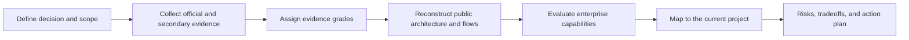

# Enterprise Project Research

An evidence-graded Codex Skill for studying enterprise software platforms, product architectures, and build-versus-buy decisions.

Most "competitor research" mixes vendor marketing, analyst opinion, and guessed internals into one confident narrative. This Skill separates those things. It reconstructs a product only from stated evidence, makes uncertainty visible, and maps useful mechanisms back to the reader's own system without copying assumptions.

## What it produces

For a full study, the Skill creates a research folder containing:

- an executive summary and research scope;
- official documentation, release notes, and a product timeline;
- a publicly reconstructed layered architecture;
- end-to-end core workflows and agent/tool boundaries;
- an enterprise capability matrix covering permissions, security, audit, deployment, cost, and operations;
- a mapping from the studied product to the user's current project;
- direct-borrow, adapt, and do-not-copy decisions;
- risks, open questions, and a prioritized action plan;
- sources, access dates, source commits, and local experiment evidence.

## Use it for

- researching a closed-source enterprise product;
- comparing BI, data, knowledge, or agent platforms;
- reconstructing a public product architecture;
- evaluating enterprise readiness or build / buy / hybrid options;
- turning research into decisions for an existing codebase.

Do not use the full workflow for a single documentation lookup or a quick answer that does not need product or architecture analysis. The Skill supports a short mode for those cases.

## Install

Clone the repository directly into your Codex Skills directory:

```bash
git clone https://github.com/cx677/enterprise-project-research.git \
  "${CODEX_HOME:-$HOME/.codex}/skills/enterprise-project-research"
```

If the destination already exists, move or back it up first. The clone command intentionally fails rather than overwriting an existing Skill.

To use a local checkout instead, link or copy this repository to:

```text
${CODEX_HOME:-$HOME/.codex}/skills/enterprise-project-research
```

The required entrypoint is `SKILL.md`; `agents/openai.yaml` enables discovery in Codex.

## Use

Invoke the Skill explicitly:

```text
Use $enterprise-project-research to research <product> and map relevant mechanisms to this project.
```

Or provide a scoped brief:

```text
Use $enterprise-project-research to compare three enterprise data-agent platforms
for a private-deployment procurement decision. Focus on permissions, audit,
semantic modeling, integration cost, and operating risk. Map the findings to
the current repository and produce P0/P1/P2 actions.
```

See [examples/enterprise-product-research-brief.md](examples/enterprise-product-research-brief.md) for a complete request template.

## Research workflow



The Skill reads detailed references only when the current task needs them:

| Reference | Purpose |
|---|---|
| [research-workflow.md](references/research-workflow.md) | Scoping, source passes, depth modes, and stop conditions |
| [evidence-standards.md](references/evidence-standards.md) | Source hierarchy, citations, dependency claims, and closed-source limits |
| [architecture-reconstruction.md](references/architecture-reconstruction.md) | Layered, workflow, and inference-labelled diagrams |
| [capability-matrix.md](references/capability-matrix.md) | Scoring, enterprise readiness gates, and build / buy / hybrid analysis |
| [output-template.md](references/output-template.md) | Report skeletons and the final quality checklist |

## Evidence grades

Material conclusions use one of four labels:

| Grade | Meaning |
|---|---|
| **Official** | The vendor or project directly states the fact |
| **Public inference** | A reasonable conclusion derived from public documentation, diagrams, code, or observable behaviour |
| **Third-party opinion** | An outside interpretation that cannot establish vendor internals |
| **Unverified** | Requires vendor confirmation, protected access, or a trial |

"No public evidence" never means a capability is absent. It means the research cannot establish it from public sources.

## Quality gates

A complete study must:

- distinguish product launch, feature listing, documentation update, and actual availability;
- label closed-source architectures as public reconstructions;
- distinguish mentioning, recommending, using, and being built on an open-source project;
- define capability scores instead of presenting unexplained numbers;
- preserve the current project's authoritative state and permission boundaries;
- record URLs, access dates, source commits, commands, and evidence files;
- separate direct borrow, adaptation, and mechanisms that should not be copied.

## Repository layout

```text
enterprise-project-research/
├── SKILL.md
├── agents/
│   └── openai.yaml
├── references/
│   ├── architecture-reconstruction.md
│   ├── capability-matrix.md
│   ├── evidence-standards.md
│   ├── output-template.md
│   └── research-workflow.md
├── examples/
│   └── enterprise-product-research-brief.md
├── scripts/
│   └── validate_package.py
└── .github/workflows/validate.yml
```

## Validate changes

```bash
python3 -m pip install pyyaml
python3 scripts/validate_package.py
```

The validator checks required files, Skill frontmatter, UI metadata, referenced files, local Markdown links, Mermaid fences, package placeholders, and obvious local absolute paths.

## Scope and limitations

This project provides a research method, not vendor facts, procurement approval, or legal advice. It cannot establish the internal implementation of a closed-source product. Source availability, documentation quality, and access permissions determine what a study can prove.

Publishing rights, licence compatibility, and trademark use remain the responsibility of the person reusing this repository.

## Security

Please report vulnerabilities privately as described in [SECURITY.md](SECURITY.md). Do not include secrets, customer data, or restricted vendor material in issues.

## Contributing

Contributions are welcome. Read [CONTRIBUTING.md](CONTRIBUTING.md) before opening a pull request. Changes must preserve evidence grading and avoid presenting guessed internals as facts.

## License

Released under the [MIT License](LICENSE).

## Trademarks

Product names, company names, and trademarks referenced in research outputs belong to their respective owners. This project is for descriptive technical research and does not imply affiliation or endorsement.
