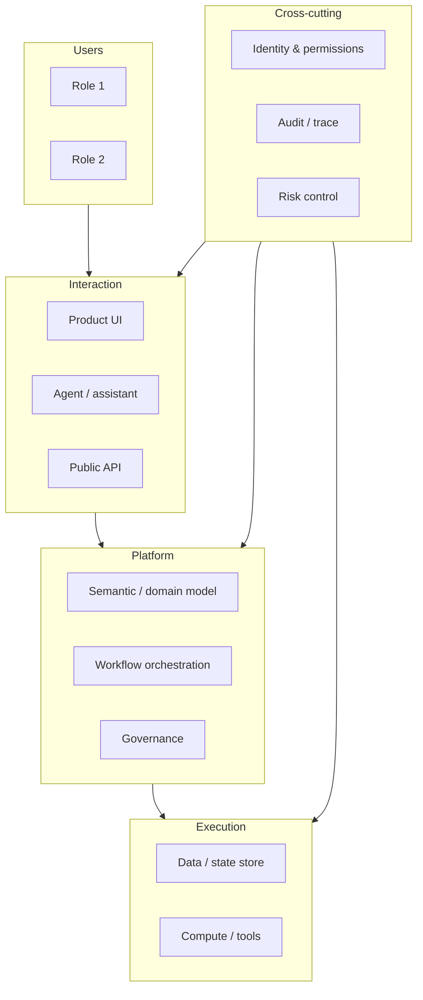
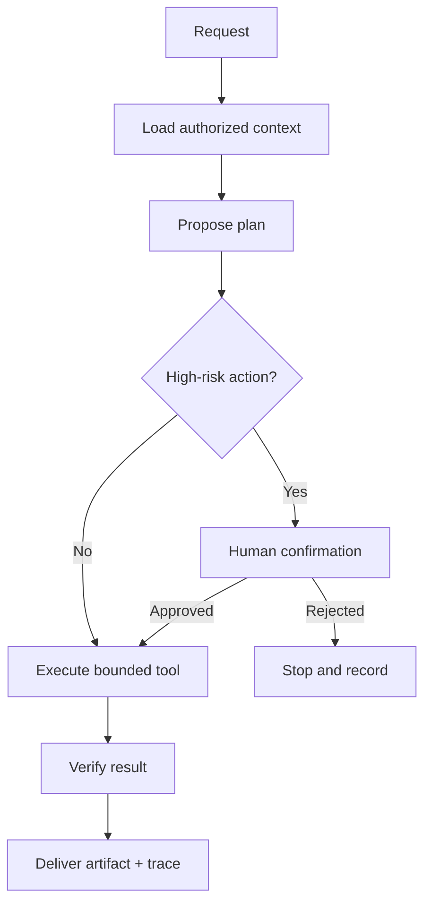

# Architecture Reconstruction

## Minimum diagrams

For a full study, produce at least:

1. **Public layered architecture** — users, interaction, agents/services, platform, data/engine, governance/security.
2. **Core end-to-end flow** — source → model/semantics → planning/query → execution → result/explanation → audit.
3. **Role or agent workflow** — input, steps, tools, permissions, human confirmation, output, failure path.
4. **Current-project mapping** — vendor mechanism → local component → borrowing action.

For data systems, also consider:

- semantic model lifecycle;
- metadata/catalog flow;
- permission flow;
- lineage;
- quality and exception handling;
- deployment topology.

## Diagram content rules

Every architecture diagram must include:

- title;
- evidence grade;
- date;
- source basis;
- inferred edges marked `inferred` or a distinct style;
- human confirmation gates where relevant;
- security/audit boundary;
- failure or degraded path when known.

Use Mermaid source files so diagrams remain maintainable. Prefer SVG for delivery. Use PNG only when the user requests a bitmap or a preview.

## Layered architecture template



## End-to-end flow template

```mermaid
flowchart LR
  Input["User request"] --> Understand["Intent / entity understanding"]
  Understand --> Semantic["Governed semantic retrieval"]
  Semantic --> Permission["Permission and scope filtering"]
  Permission --> Plan["Controlled query or task plan"]
  Plan --> Execute["Execution engine / tools"]
  Execute --> Result["Result artifact"]
  Result --> Explain["Explanation / lineage"]
  Explain --> Audit["Audit trace"]
```



## Agent workflow template

For each agent or role workflow, document:

```text
Role
Trigger
Input
Context required
Tools allowed
Permission boundary
Plan / steps
Outputs
Validation
Human confirmation
Failure handling
Audit record
```

Example:



## Inference discipline

For each node and edge, ask:

- Is this named in official documentation?
- Is this directly observable in a demo or API?
- Is this required to explain the documented behavior?
- Is this only a plausible implementation choice?

Use wording such as:

```text
Official: the product exposes a semantic model containing metrics and dimensions.
Public inference: the analysis agent likely consumes this semantic model before query execution.
Third-party opinion: the author claims an internal SQL engine, but the vendor does not publicly specify it.
```

## Text architecture summary

Accompany every diagram with a short explanation:

1. purpose;
2. layers;
3. state and authority;
4. execution path;
5. permission boundary;
6. failure/degraded path;
7. inferred parts;
8. design implications.
